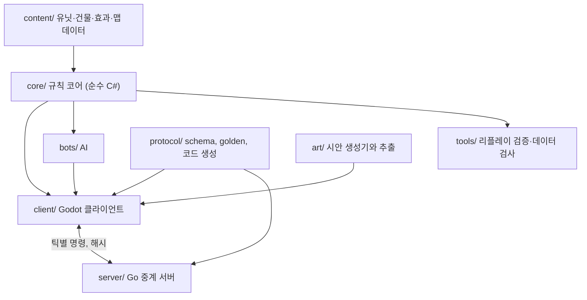
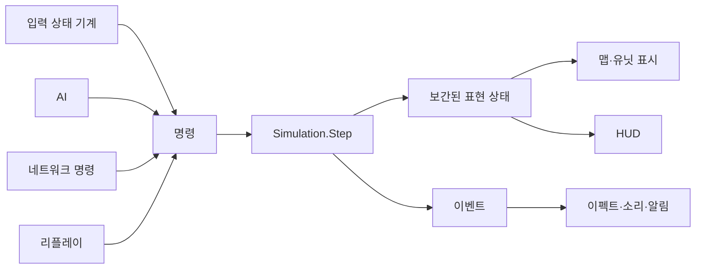

# 삼재 전체 개선안

> 상태: 제안. 결정 전이며, 아직 어떤 코드도 이 문서에 따라 바뀌지 않았다.

## 결론

규칙 코어를 언어와 엔진에서 독립시키고, 클라이언트는 Godot 4로 새로 만들며, 네트워크는 Go 서버를 살린 락스텝 중계로 바꾸는 것을 권장한다.

| 영역 | 지금 | 제안 |
| --- | --- | --- |
| 규칙 코어 | Kotlin, `App.kt`와 얽힘, `Float` 좌표 | C# 순수 라이브러리, 고정소수점 좌표, 입출력 없음 |
| 클라이언트 | libGDX, 직접 그리는 도형과 HUD | Godot 4 (C#), 아이소메트릭 타일맵과 테마 UI는 엔진 기능 사용 |
| 로컬 플레이 | JVM 프로세스 2개가 NDJSON 파일로 통신 | 한 프로세스 안에서 코어 호출 |
| 네트워크 | Go 서버가 별도의 간이 규칙으로 판정 | Go 서버는 규칙 없이 명령 중계와 해시 비교만 담당 |
| 콘텐츠 | 종족 규칙이 코드로 들어갈 예정 | 데이터 + 소수의 효과 기본 요소 |
| 범위 | 3종족, 영웅 9명을 차례로 구현 | 2종족 1맵의 완성본을 먼저 만들고 확장 |

**이렇게 판단한 근거는 하나다. 지금이 언어를 바꾸기 가장 싼 시점이다.** 규칙 코드는 2,402줄뿐이고, 클라이언트 18,441줄은 어느 쪽을 택해도 대부분 다시 써야 한다. 5단계에서 종족 규칙이 들어가면 이 비율이 뒤집힌다.

바로 전환하지 않는다. 먼저 작은 시험 구현으로 Godot이 이 게임에 맞는지 확인한다([전환 단계](#전환-단계)의 P0). 시험에 실패하면 [선택지 A](#선택지-비교)로 돌아가며, 이 경우에도 아래 구조 개선은 같게 적용한다.

## 현재 상태 진단

2026-11-05에 저장소에서 측정한 값이다.

### 코드 분포

| 영역 | 줄 수 | 비고 |
| --- | --- | --- |
| `sim/.../client` | 18,441 | `sim/` 본 코드의 64% |
| `sim/.../App.kt` | 5,935 | 함수 151개, `main`만 약 930줄 |
| `sim/.../ecs` | 2,402 | **실제 게임 규칙** |
| `sim/.../net`, `replay`, `data` | 1,702 | |
| `sim/src/test` | 13,566 | 파일 39개 |
| `server` (Go) | 4,040 | 테스트 포함 |
| `client` (Go) | 1,977 | 헤드리스 클라이언트와 봇 |
| `tools` | 2,493 | |

### 구조 문제

1. **코어와 클라이언트가 분리되어 있지 않다.** 규칙, CLI, 스트림 출력, 클라이언트 코드가 한 Gradle 모듈에 있다. `App.kt`는 `client` 패키지를 73번 가져온다. 규칙이 UI를 모른다는 원칙을 빌드가 강제하지 않는다.
2. **규칙이 두 벌이다.** Go `room.go`는 Kotlin sim을 호출하지 않고 이동, 공격, 건설, 생산을 따로 구현한다. 새 종족을 대전에 넣으려면 두 번 구현해야 한다.
3. **로컬 플레이가 파일 통신이다.** JVM 2개가 NDJSON 파일로 대화한다. 스냅샷은 평균 36KB, 2틱마다 쓰므로 초당 25개, 약 0.9MB/s를 JSON으로 쓰고 다시 읽는다. 입력도 파일을 거쳐 다음 틱에 반영된다.
4. **프로토콜 모델이 세 벌이다.** Go 서버, Go 클라이언트, Kotlin에 각각 손으로 작성되어 있다.
5. **클라이언트가 거대 파일 위주다.** `GameScreen` 3,443줄, `GdxWorldRenderer` 3,051줄, `ClientSnapshot` 2,232줄이다. AWT 시절 코드(`GraphicalClient`, `ClientRenderer`, 3,345줄)도 남아 있다.
6. **아이소메트릭 전환 비용이 크다.** 좌표 변환 호출 151곳을 바꿔야 하고, HUD와 지형, 안개(`drawFog`는 비어 있음), y 정렬, 애니메이션을 직접 만들어야 한다.

### 결정론 위험

- 좌표가 `Float`이고 `hypot`을 쓴다. 같은 JVM 안에서는 재현되지만, 운영체제와 CPU가 섞인 대전에서 안전하다고 증명된 적이 없다.
- 서버와 sim의 해시는 비교할 수 없다.
- 해시 테스트 3건이 오랫동안 깨진 채로 있었다. 기준값을 손으로 고치는 방식의 한계다.

### 성능

- `:sim:benchmark`는 틱당 p50 20µs, p99 1.7ms, 최대 41.9ms다. 틱 예산은 20ms다.
- **다만 이 장면은 유닛 20개뿐이다.** 시안의 전투 규모를 대표하지 않으므로 여유가 충분하다고 결론 내릴 수 없다.
- 컴포넌트를 해시맵(`mutableMapOf`)에 저장해 유닛 수가 늘면 비용이 커질 가능성이 있다.
- 그래픽 클라이언트의 FPS는 아직 측정한 적이 없다.

### 유지할 가치가 있는 자산

- 디자인 시안과 생성기, 스프라이트 추출 파이프라인
- `COMMAND_CONTRACT.md`, HUD·입력 명세, 프로토콜 schema와 golden
- 13,566줄의 테스트: 코드는 옮겨야 하지만 **기대 동작 명세**로 쓸 수 있다
- Go 서버의 방 관리, 세션 재개, 검증, 리플레이 기록
- 리플레이 검증과 스모크 스크립트 체계

## 목표와 원칙

1. **규칙은 한 곳에만 있다.** 클라이언트, 봇, 검증 도구가 같은 코어를 쓴다.
2. **코어는 입출력을 모른다.** `명령 + 이전 상태 → 다음 상태 + 이벤트`만 한다. 파일, 소켓, 시계, 렌더링이 없다.
3. **결정론은 플랫폼을 넘어 보장한다.** 부동소수점을 코어에서 없앤다.
4. **엔진이 해주는 일은 직접 만들지 않는다.** 코드는 게임만의 규칙에 쓴다.
5. **콘텐츠 추가에 코드가 거의 필요 없어야 한다.**
6. **언제나 플레이 가능한 상태를 유지한다.**

## 선택지 비교

| | A. Kotlin + libGDX 유지, 구조만 개선 | **B. C# 코어 + Godot 4 (권장)** | C. TypeScript + PixiJS, 웹 | D. Rust 코어 + Godot 또는 Bevy | E. Unity (C#) |
| --- | --- | --- | --- | --- | --- |
| 기존 코드 재사용 | 높음, 코어와 테스트 유지 | 낮음, 명세로만 재사용 | 낮음 | 낮음 | 낮음 |
| 아이소메트릭, y 정렬 | 직접 구현 | 엔진 기능 | 일부 직접 구현 | Godot은 엔진 기능, Bevy는 직접 구현 | 엔진 기능 |
| 장식 HUD, 한글 | 직접 구현, freetype 추가 | 테마와 나인패치 | **HTML·CSS로 시안 재사용 가능** | Godot은 동일 | 엔진 기능 |
| 편집기 | 없음 | 있음 | 없음 | Godot만 있음 | 있음 |
| 코어 재작성 부담 | 없음 | 낮음, Kotlin과 문법이 비슷 | 낮음 | 높음 | 낮음 |
| 결정론 | 고정소수점 도입 필요 | 고정소수점 도입 필요 | 정수 연산 규율 필요 | 가장 강함 | 고정소수점 도입 필요 |
| 배포 | JVM 동봉 | 데스크톱 네이티브 | **URL 하나** | 데스크톱, 웹 | 전 플랫폼 |
| 주요 약점 | 앞으로의 작업량이 가장 큼 | C# 프로젝트 웹 내보내기 미지원 | RTS 데스크톱 판매에 추가 포장 필요 | 개발 속도, 학습 비용 | 라이선스 정책 변동 이력, 무거운 편집기 |

**B를 권장하는 이유**

- 이 게임의 어려운 부분인 아이소메트릭 지형, 정렬, 장식 UI, 애니메이션, 파티클, 오디오는 Godot의 기본 기능에 해당한다. A를 택하면 이 전부가 앞으로의 코드가 된다.
- 코어가 2,402줄이고 C#은 Kotlin과 비슷해 옮기는 부담이 작다. Godot 없이 일반 .NET에서 코어를 빌드하고 테스트할 수 있다.
- Godot과 .NET은 MIT 라이선스다.

**다른 선택지가 나은 경우**

- **웹에서 바로 플레이가 중요하면 C.** Godot 4의 C# 웹 내보내기는 지원을 준비 중이지만 일정이 정해지지 않았다. 웹이 필수라면 B에서 제외된다. 다만 이 현황은 포럼 자료로 확인한 것이므로 결정 전에 공식 문서를 다시 본다.
- **Kotlin 유지가 목표 자체라면 A.** 포트폴리오 성격이나 익숙함이 더 중요할 때 합리적이다. 아래 구조 개선은 A에서도 그대로 적용한다.
- D는 결정론이 가장 강하지만, 혼자 또는 소규모로 콘텐츠를 많이 만들어야 하는 이 프로젝트에는 개발 속도 손실이 더 크다고 판단했다.

## 목표 아키텍처



### 저장소 구성

| 경로 | 책임 | 의존 |
| --- | --- | --- |
| `core/` | 규칙, 상태, 해시 | 없음 (엔진, 입출력 금지) |
| `core.tests/` | 규칙 단위 테스트, 시나리오, 해시 | `core` |
| `content/` | JSON 데이터와 스키마 | 없음 |
| `bots/` | AI, 명령을 만드는 쪽으로만 코어와 연결 | `core` |
| `client/` | Godot 프로젝트, 렌더링, 입력, UI, 오디오 | `core`, `bots` |
| `server/` | 방, 세션, 명령 중계, 리플레이 기록 (Go) | `protocol` |
| `tools/` | 리플레이 검증, 데이터 검사, 대량 자동 대전 | `core`, `bots` |
| `protocol/` | schema, golden, 모델 코드 생성 | 없음 |
| `art/` | 시안, 스프라이트와 아틀라스 추출 | 없음 |

코어의 의존 금지는 문서가 아니라 프로젝트 참조로 강제한다. `core`는 Godot도 네트워크도 참조할 수 없다.

### 규칙 코어

```csharp
public sealed class Simulation {
    public static Simulation Create(MatchSetup setup, GameContent content);
    public StepResult Step(ReadOnlySpan<PlayerCommand> commands);
    public IWorldView View { get; }
    public ulong ComputeHash();
    public byte[] SaveState();
}
```

- **좌표와 수치:** 고정소수점 정수를 쓴다. 삼각함수와 제곱근은 코어 자체 구현 또는 표를 쓴다. 코어 빌드에서 `float`과 `double` 사용을 분석기로 금지한다.
- **상태 저장:** 해시맵 대신 ID 오름차순으로 도는 밀집 배열을 쓴다. 순회 순서가 곧 결정론이므로 자료구조가 이를 보장하게 한다.
- **난수:** 시드 기반 난수 하나만 쓰고, 상태에 포함해 해시한다.
- **시스템 순서:** 한곳에 목록으로 선언한다.
- **틱 속도:** 지금의 50틱/초를 유지할 이유를 재검토한다. RTS는 더 낮은 틱에 화면 보간을 쓸 수 있고, 그만큼 CPU와 통신이 줄어든다. 20~25틱/초를 후보로 P0에서 실험한다.
- **상태 저장·복원:** 리플레이 되감기, 동기화 오류 분석, 재접속에 함께 쓴다.

### 콘텐츠: 데이터 + 효과 기본 요소

시안의 종족 규칙 대부분은 몇 가지 요소의 조합이다. 유닛마다 코드를 쓰지 않고 이 요소를 데이터로 엮는다.

| 기본 요소 | 쓰는 곳 |
| --- | --- |
| 상태 효과 (지속, 중첩, 수치 변경) | 무당의 약화, 요물의 성장 |
| 영역 (범위, 소속, 지속) | 오방 신당의 성역, 오방신장의 오라, 어둑시니의 시야 가림 |
| 트리거 (사망, 피격, 처치, 진입) | 조선 공방의 잔해, 저승사자의 혼 수거 |
| 소환과 소속 변경 | 창귀가 쓰러진 적을 끌어들임, 혼이 머묾 |
| 대상 지정 스킬과 쿨다운 | 영웅 스킬 전체 |
| 이동 계층 (지상, 공중) | 비거, 솟대 오리, 어둑시니 |

```json
{
  "id": "mudang_bell",
  "target": { "shape": "circle", "radius": "6", "faction": "enemy" },
  "cooldownTicks": 200,
  "effects": [{ "type": "applyStatus", "status": "weakened", "durationTicks": 100 }]
}
```

데이터로 표현되지 않는 규칙만 이름 붙은 코드 효과로 추가한다. 위 JSON은 형태를 보여 주는 예시이며 수치는 확정이 아니다.

### 네트워크: 락스텝 중계

| | 지금: 서버가 판정 | 제안: 락스텝 중계 |
| --- | --- | --- |
| 서버가 규칙을 아는가 | 안다, 그래서 규칙이 두 벌 | **모른다** |
| 통신량 | 상태를 전송 | 명령만 전송 |
| 리플레이 | 명령 + 키프레임 | 시드 + 명령, 그 자체로 재현 가능 |
| 부정행위 검증 | 서버가 판정 | 해시 비교로 감지, 도구로 재검증 |
| 약점 | 규칙 이중 구현 | 전체 상태가 클라이언트에 있어 맵핵을 막기 어려움 |

- 서버는 틱별 명령을 모아 양쪽에 보내고, 양쪽이 보낸 해시를 비교한다. 다르면 대전을 중단하고 리플레이를 남긴다.
- 지금의 방 관리, 재개 토큰, 입력 검증, 속도 제한은 유지하고, `room.go`의 규칙 부분만 삭제한다. 프로토콜은 v2로 올린다.
- 공식 대전이나 순위전이 목표가 되면 맵핵이 실질적인 문제가 된다. 그때는 `core`를 서버에서 돌려 시야를 걸러 보내는 방식을 추가한다. 코어가 독립되어 있으므로 나중에 추가할 수 있다.

### 클라이언트



- **명령 입구는 하나다.** 플레이어, AI, 네트워크, 리플레이가 같은 경로를 쓰므로 자동 테스트가 실제 플레이와 같은 경로를 탄다.
- **화면은 코어를 읽기만 한다.** 틱 사이는 보간해 부드럽게 그린다.
- **지형:** 아이소메트릭 `TileMapLayer`를 쓴다. 코어의 격자는 그대로 두고 화면 투영만 엔진이 맡는다.
- **유닛:** 스프라이트 아틀라스와 `AnimatedSprite2D`, y 정렬을 쓴다. 수가 많으면 `MultiMesh`나 서버 API로 내려간다.
- **안개:** 코어의 시야 데이터를 텍스처로 올려 셰이더로 그린다.
- **HUD:** 시안의 틀을 나인패치로 추출하고 `Theme`으로 묶는다. 색 토큰과 글꼴을 테마 한곳에서 관리한다.
- **입력:** `COMMAND_CONTRACT.md`를 기존 테스트 내용과 함께 상태 기계로 옮긴다.

### 아트 파이프라인

현재의 `export_sprites.py`를 확장한다. 엔진이 바뀌어도 대부분 재사용한다.

- 출력: 방향·동작별 프레임 → 아틀라스 PNG + 데이터
- 크기 예산을 스크립트에서 검사한다.
- 시안의 그림은 큰 크기 기준이므로 실제 표시 크기로 미리보기 시트를 뽑아 사람이 판단한다.
- **방향 수를 일찍 정한다.** 그림 작업량을 가장 크게 좌우한다. 5방향을 그리고 좌우 반전하면 프레임 수가 곧바로 5배가 된다. `figure_kit` 관절로 어느 방향까지 자연스럽게 뽑히는지 P0에서 시험한다.

### 검증 체계

| 층위 | 내용 |
| --- | --- |
| 단위 | 효과 기본 요소, 고정소수점, 경로 탐색 |
| 시나리오 | 데이터로 쓴 상황 → 결과 확인 (유닛 A가 B를 몇 틱에 처치) |
| 리플레이 묶음 | 기록된 경기를 재생해 해시 확인. 규칙 변경 시 차이를 사유와 함께 갱신 |
| 플랫폼 교차 | Windows, macOS, Linux에서 같은 리플레이의 해시 비교 (CI 매트릭스) |
| 자동 대전 | 종족 조합별 수천 판, 승률과 평균 시간으로 밸런스와 멈춤 탐지 |
| 성능 | 유닛 200개 이상 기준 장면, 틱 시간과 FPS 회귀를 CI에서 감시 |

플랫폼 교차 해시는 지금 없는 검증으로, 락스텝 전환의 전제 조건이다.

## 제품 범위 개선

지금 계획은 3종족, 유닛 약 20종, 건물 21종, 영웅 9명이다. 혼자 또는 소규모로 끝까지 구현하기에 위험할 만큼 크다. 특히 유닛마다 걷기와 공격 프레임을 만드는 일이 프로그래밍보다 오래 걸릴 수 있다.

| 마일스톤 | 범위 | 확인할 것 |
| --- | --- | --- |
| 완성 조각 | 人 대 地, 각 유닛 3종과 건물 3종, 맵 1개, AI 1단계, 영웅 없음 | **재미있는가**, 그림이 작은 크기에서 읽히는가 |
| 2종족 완성 | 人, 地 전체 로스터, 맵 3개, 온라인 대전 | 밸런스, 네트워크 |
| 3종족 완성 | 天 추가, 성역 규칙 | 세 종족의 차이 |
| 영웅 | 영웅 9명 | 스킬 시스템 |

게임 자체에도 지금 설계에 없는 것이 있다. 완성 조각 단계에서 함께 정한다.

- **혼자 하는 경로:** 튜토리얼, AI 난이도, 짧은 임무. 1:1만으로는 처음 온 사람이 게임을 끝까지 경험하기 어렵다.
- **편의 기능:** 단축키 설정, 관전, 리플레이 탐색 UI, 전투 후 통계.
- **접근성:** 진영색 외의 구분 표시, UI 크기 조절, 한국어 외 언어를 위한 문자열 분리.
- **오디오:** 합성음은 임시로 두고, 국악 음색 방향은 완성 조각 평가 후 결정한다.

## P0 진행 결과 (2026-11-05)

코드는 `spike/`에 있다. 측정 PC는 Apple M1 Max 1대이고, 다른 작업 때문에 load average가 50~70인 상태였다. 빌드는 Debug 어셈블리와 Godot 편집기 실행 파일이다. 저사양 PC 측정은 아직 없다.

| 통과 기준 | 상태 | 근거 |
| --- | --- | --- |
| 기준 장면 60 FPS | 이 PC에서 통과 | 아래 표 |
| 클릭 좌표 정확 | 통과 | 실제 입력 경로로 좌클릭 800회, 우클릭 2,000회 오류 0. 엔진 타일 조회와 2만 지점 대조 오류 0. 1280×720 창과 headless(64×64 창, 1440×1440 논리 화면)에서 확인 |
| 한글 표시 정상 | macOS만 확인 | 시스템 글꼴 사용. 출시에는 글꼴을 동봉해야 하고 Windows, Linux는 미확인 |
| 3개 OS 해시 일치 | **미확인** | CI 작성 완료, 브랜치 푸시 전이라 실행하지 않음. macOS에서 일반 .NET과 Godot 내부 코어의 600틱 해시는 일치 |
| 개발자가 편하다고 판단 | **미판단** | 직접 실행해 판단 필요 |

| 장면 (1440×900, 30초) | 평균 FPS | 프레임 p99 | 틱 p99 |
| --- | --- | --- | --- |
| 유닛 200, 군중 추적 (화면 내 평균 122), 호환 렌더러 | 313 | 9.5ms | 1.6ms |
| 유닛 200, 맵 전체 (화면 내 200), 호환 렌더러 | 278 | 9.9ms | 1.5ms |
| 유닛 1,000, 군중 추적 (화면 내 평균 609), 호환 렌더러 | 178 | 14.9ms | 2.6ms |
| 유닛 200, 군중 추적, Forward+ 렌더러 | 110 | 34.7ms | 1.5ms |

프레임 최대값은 45~106ms까지 튀었다. 부하가 원인인지는 분리하지 못했다.

**이 시험이 다루지 않은 것:** 전투, 애니메이션, 이펙트, 안개, 나인패치 HUD 틀은 없다. 지형은 임시 그림이고 HUD는 시안의 배치와 색만 따랐다. 방향별 스프라이트 실험과 틱 속도 비교도 하지 않았고, 틱은 20틱/초로 고정했다. 렌더러는 호환 렌더러를 기본으로 두었다.

## 전환 단계

단계마다 통과 기준이 있고, P0를 통과하기 전에는 기존 코드를 지우지 않는다. 규모는 상대적 크기다. 일정은 P0 결과를 본 뒤 추정한다.

| 단계 | 내용 | 규모 | 통과 기준 |
| --- | --- | --- | --- |
| **P0 시험 구현** | Godot에 아이소메트릭 맵, 유닛 200개, 건물 20개, 시안 HUD 1화면. 고정소수점 코어 시제품, 3개 OS 해시 비교 | 소 | 기준 장면 60 FPS, 클릭 좌표 정확, 한글 표시 정상, 3개 OS 해시 일치, 개발자가 편하다고 판단 |
| **P1 코어 이식** | 저장소 구성, `ecs/` 이식, 기존 테스트를 명세로 옮김, 효과 기본 요소 | 중 | 옮긴 시나리오 전부 통과, 자동 대전 끝까지 진행, 해시 재현 |
| **P2 조작 가능한 게임** | 지형, 선택, 이동, 공격, 건설, 생산, 입력 상태 기계, 안개 | 중 | `COMMAND_CONTRACT.md` 시나리오 통과, 기존 게임의 기능을 대체. **여기서 Kotlin 클라이언트 삭제** |
| **P3 완성 조각** | 人 대 地 축소판, 시안 HUD·메뉴·결과 화면, 애니메이션, 소리, AI 1단계 | 대 | 외부 사람이 튜토리얼 없이 AI를 이기거나 지는 판을 끝낼 수 있음 |
| **P4 온라인** | 프로토콜 v2, `room.go` 규칙 제거, 중계, 해시 비교, 재접속 | 중 | 다른 OS끼리 대전 끝까지 일치, e2e 스모크 통과 |
| **P5 콘텐츠 확장** | 2종족 전체, 天, 영웅 순서로 추가 | 대 | 자동 대전 통계로 밸런스 확인 |
| **P6 출시 준비** | 패키징, 상표 조회, 코드 이름 정리, 라이선스, 플레이테스트 | 중 | 배포본이 깨끗한 PC에서 실행됨 |

### 기존 계획과의 관계

| 기존 단계 ([계획서](sampajeon-application-plan.md)) | 이 개선안에서 |
| --- | --- |
| 1 스프라이트 | PNG 파이프라인은 유지, libGDX 코드는 P2에서 폐기 |
| 2 아이소메트릭 | 시작하지 않는다. **151곳 수정 작업이 사라진다** |
| 3 UI와 글꼴 | P3로 흡수, 글꼴 파일 허락은 그대로 필요 |
| 4 데이터 재편 | P1로 흡수 |
| 5, 6 종족과 영웅 | P5, 일부는 P3 |
| 7 연출 | P3, P5 |
| 8 네트워크 | P4, 규칙 이중 구현 문제가 사라진다 |

### 지우는 것과 남기는 것

| 처리 | 대상 |
| --- | --- |
| 삭제 (P2 이후) | `sim/` Kotlin 전체, `client/` Go 헤드리스 클라이언트 중 대체된 부분, `room.go`의 규칙 |
| 이식 | 규칙, 테스트의 기대 동작, 리플레이 형식, `tools` 기능 |
| 유지 | Go 서버의 세션·방·검증, 시안과 생성기, 명세 문서 |
| 정리 | `docs/` 39개 문서(7,096줄) 중 사라진 구조를 설명하는 문서는 전환 시 고치거나 삭제 |

## 위험

| 위험 | 영향 | 대응 |
| --- | --- | --- |
| 재작성이 끝나지 않음 | 프로젝트 정지 | P0 통과 기준을 엄격히 적용, P2 전까지 Kotlin 판 유지, 기능 추가 금지 |
| Godot이 RTS 규모에서 느림 | 유닛 수 제한 | P0에서 측정, 필요하면 `MultiMesh`와 서버 API |
| 고정소수점 도입으로 이동이 어색함 | 조작감 저하 | 화면 보간과 분리, P1에서 이동 품질 확인 |
| 웹 배포가 나중에 필요해짐 | C# 때문에 불가능할 수 있음 | 결정 전에 플랫폼 확정, Godot의 지원 진행 상황 확인 |
| C#에 익숙하지 않음 | 초기 속도 저하 | P0에서 판단 |
| 맵핵 | 순위전에서 공정성 문제 | 지금은 수용, 필요 시 서버 실행 방식 추가 |
| 그림 작업량 폭증 | 일정 지연 | 방향 수와 프레임 수 먼저 결정, 완성 조각으로 범위 제한 |
| 포트폴리오 설명이 달라짐 | 기존 문서와 어긋남 | Kotlin 이력은 Git에 남고, "코어 분리, 교차 플랫폼 결정론"이 더 강한 설명이 된다 |

## 결정이 필요한 사항

출시 플랫폼은 **데스크톱 중심**으로 정했다(2026-11-05). 따라서 웹 배포를 전제로 하는 선택지 C는 권장안에서 제외하고, Godot C#의 웹 내보내기 미지원은 당장의 제약이 아니다.

언어는 **C#으로 전환**하기로 정했다(2026-11-05). 다만 Godot 채택과 Kotlin 코드 삭제는 P0와 P2의 통과 기준을 만족한 뒤에 확정한다.

1. **프로젝트 목표:** 판매할 게임, 무료 공개, 포트폴리오 중 어디에 가까운가? 범위와 맵핵 대응이 달라진다.
2. **범위:** 2종족 완성 조각을 먼저 만드는 데 동의하는가?
3. **P0 진행 여부:** 위 결정 후 시작한다. Godot과 .NET SDK 설치가 필요하므로 시작 전에 다시 확인한다.

## 확인 수준

- **실측:** 코드 줄 수, 의존 관계, 스냅샷 크기, 벤치마크 값.
- **외부 자료 확인:** Godot C# 웹 내보내기 현황과 고정소수점 권장은 포럼과 개발자 글로 확인했다. 공식 보증 문서는 아니다.
- **미검증 판단:** Godot이 이 게임에 적합하다는 판단과 규모 추정은 실제로 시험해 본 결과가 아니다. P0가 이를 확인하기 위한 단계다.
